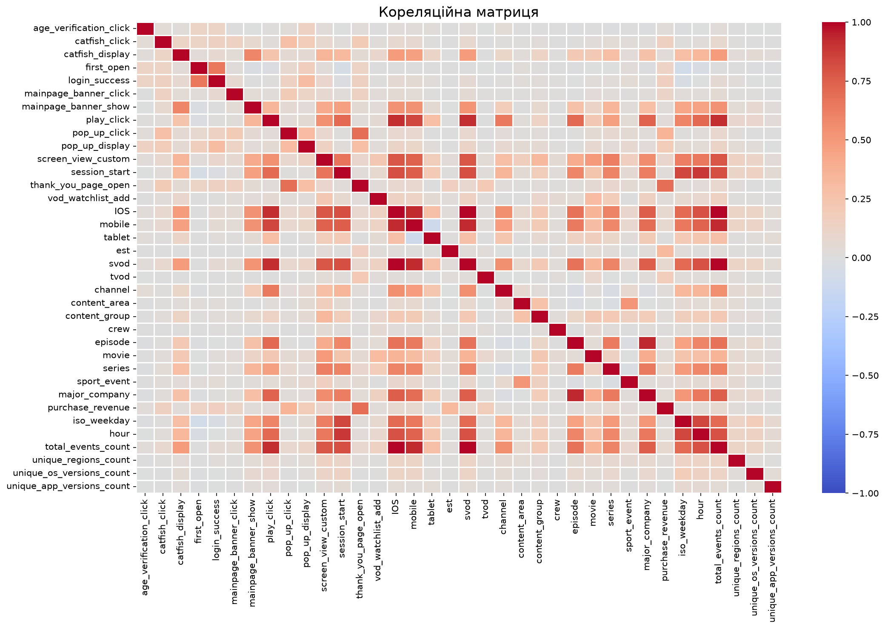
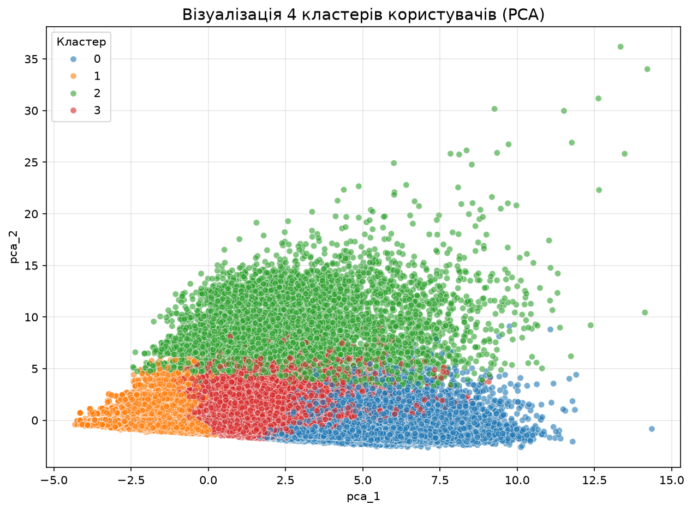
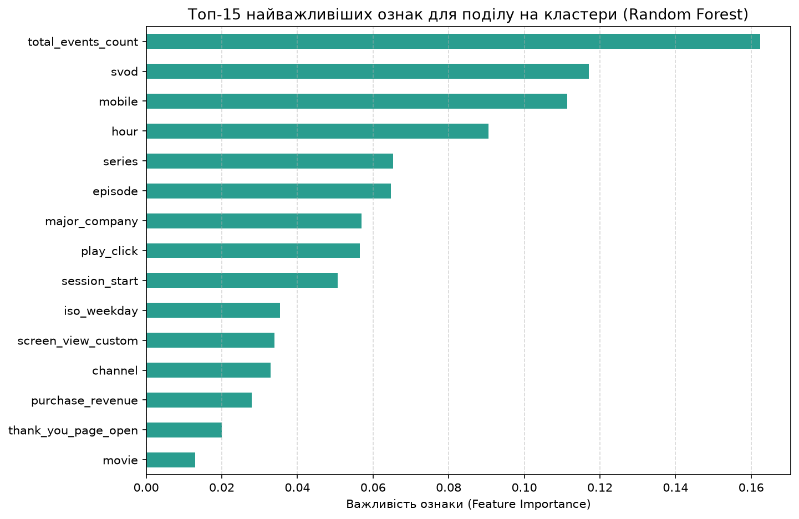

# Аналітика користувачів мобільного OTT-застосунку (iOS)

Аналітичний кейс «від сирих даних до сегментів користувачів»: збір користувацького датасету з подій і довідників, кореляційний аналіз, кластеризація користувачів (K-Means + PCA) та інтерпретація кластерів за допомогою Random Forest і Feature Importance.

**Стек:** Python (pandas, NumPy, scikit-learn, matplotlib, seaborn) · SQL · Power BI

---

## Бізнес-задача

Зрозуміти, з яких груп складається аудиторія стрімінгового застосунку, як вони поводяться (перегляд контенту, взаємодія з монетизаційними елементами, покупки) і які ознаки найсильніше відрізняють одну групу від іншої. Такі сегменти можна використовувати для таргетування промо, оптимізації монетизаційних воронок і роботи з утриманням.

## Ключові висновки

- **244 093 користувачі** розділено на **4 поведінкові сегменти**: пасивні (53%), глядачі ТБ-каналів (30%), активні глядачі серіалів і фільмів (15%) та покупці (2%).
- **Покупці — це 2.2% аудиторії, але ~99.8% виручки** за період (у середньому 128 на користувача). Вони частіше за інших є новими користувачами (`first_open`, `login_success`) → купують невдовзі після реєстрації.
- **Поп-ап — найефективніша монетизаційна воронка:** у сегменті покупців CTR поп-апа ~33% проти ~5% у кетфіша і ~7% у банера.
- **Найактивніший сегмент майже не купує:** у середньому 10 показів кетфіша на користувача при CTR ~0.2% → ознаки «банерної сліпоти» і точка росту для персоналізованих пропозицій.
- **Половина аудиторії пасивна:** ~1 сесія і менше одного перегляду за тиждень → головний ресурс для онбордингу та утримання.
- Random Forest відтворює розподіл по кластерах з точністю **98.3%** (F1 ≥ 0.97 для кожного кластера) → сегменти чітко розділені й добре інтерпретуються.

---

## Дані

Три таблиці: одна факт-таблиця подій і два довідники.

- Дані лише по платформі **iOS**. Розрізи: тип пристрою (`category`), країна, версія застосунку, версія ОС.
- Період: кілька днів (≈ тиждень), тому retention обмежений горизонтом D1.
- **Покупка** — це подія `thank_you_page_open`, вартість береться з `dim_product.product_price`.
- Три монетизаційні воронки «показ → клік → покупка», кожна завершується `thank_you_page_open`:
  - **кетфіш:** `catfish_display` → `catfish_click`
  - **поп-ап:** `pop_up_display` → `pop_up_click`
  - **банер:** `mainpage_banner_show` → `mainpage_banner_click`

> ⚠️ **Примітка щодо обсягу.** Довідники в репозиторії повні. Файл подій скорочено до **1 000 рядків** (рівномірна випадкова вибірка по кожному дню) через обмеження GitHub на розмір файлів. Увесь аналіз і всі графіки в цьому репозиторії побудовані на **повному** файлі подій (~1.6 ГБ). На скороченому файлі код запускається, але числові результати відрізнятимуться.
>
> Дані знеособлені: ідентифікувати користувача неможливо.

### Таблиця подій: `events_ios_short`

| Колонка | Опис |
|---|---|
| `event_date` | Дата події (DATE) |
| `event_datetime` | Дата й точний час події (TIMESTAMP). У частині рядків дата може не збігатися з `event_date` через часовий пояс |
| `user_pseudo_id` | Унікальний ідентифікатор користувача |
| `event_name` | Назва події (14 типів, див. нижче) |
| `platform` | Платформа, завжди `IOS` |
| `package_id` | Ідентифікатор тарифу/пакета → `dim_product.product_id` |
| `asset_id` | Ідентифікатор контенту → `dim_asset.asset_id`. Заповнений лише для подій із контентом (`play_click`, `vod_watchlist_add`, частина покупок і `screen_view_custom`) |
| `category` | Тип пристрою: `mobile` або `tablet` |
| `operating_system_version` | ОС і версія, напр. `iOS 26.5`, `iOS 18.7.8` |
| `country` | Країна користувача |
| `app_info_version` | Версія застосунку, напр. `3.1.6` |

### Довідник контенту: `dim_asset`

| Колонка | Опис |
|---|---|
| `asset_id` | Унікальний ключ контенту |
| `asset_name` | Назва контенту (канал, фільм, серіал, спортивна подія) |
| `asset_type` | Тип: `movie`, `episode`, `series`, `channel`, `content_group`, `crew`, `content_area`, `sport_event` |
| `major_company` | Для фільмів/серіалів: компанія-правовласник (Disney, Warner Bros, Universal, Paramount тощо) |

### Довідник тарифів: `dim_product`

| Колонка | Опис |
|---|---|
| `product_id` | Унікальний ідентифікатор тарифу/пакета |
| `product_name` | Назва тарифу |
| `product_price` | Ціна підписки/покупки |
| `payment_type` | Тип оплати: `svod` (підписка), `tvod` / `est` (покупка окремого фільму чи серіалу), `free`, `avod` |

### Ключі для JOIN

```
events_ios_short.asset_id   → dim_asset.asset_id
events_ios_short.package_id → dim_product.product_id   -- різні назви колонок!
```

### Типи подій (`event_name`)

| Подія | Опис |
|---|---|
| `first_open` | Перше відкриття застосунку (новий користувач) |
| `session_start` | Початок сесії |
| `login_success` | Успішна реєстрація / авторизація |
| `screen_view_custom` | Відкриття сторінки (фільм / серіал / головна / моє відео …) |
| `play_click` | Перегляд контенту (канали, фільми, серіали) |
| `vod_watchlist_add` | Додавання фільму/серіалу в обране |
| `catfish_display` / `catfish_click` | Показ кетфіша (закріплений промоелемент у хедері) / клік «Підключити» |
| `mainpage_banner_show` / `mainpage_banner_click` | Показ банера покупки пакета / клік «Підключити» |
| `pop_up_display` / `pop_up_click` | Показ поп-апа покупки пакета / клік «Підключити» |
| `thank_you_page_open` | Покупка підписки або окремого контенту (TVOD/EST) |
| `age_verification_click` | Клік «Підтвердити» на банері 21+ |

---

## Етапи аналізу

### 1. Побудова користувацького датасету → `user_df`

Три таблиці (події + 2 довідники) об'єднуються в один датасет, де **один рядок — один унікальний користувач**. Для кожного користувача рахуються агрегати його подій за тиждень (активність, перегляди, взаємодія з монетизаційними воронками, покупки) і додаються атрибути з довідників (тип контенту, тарифи, ціна).


### 2. Кореляційний аналіз

Кореляційна матриця фіч `user_df`: пошук взаємозв'язків між поведінковими метриками і відбір ознак для кластеризації.



### 3. Кластеризація користувачів

Кластеризація користувачів за поведінковими ознаками (кількість подій кожного типу, типи переглянутого контенту, типи оплати, виручка, різноманітність днів/годин активності, пристроїв і версій). Оптимальна кількість кластерів: **4**. Для візуалізації простір фіч зменшено до двох компонент методом PCA.



#### Розмір сегментів

| Кластер | Сегмент | Користувачів | Частка |
|---|---|---:|---:|
| 0 | Активні глядачі серіалів і фільмів | 35 839 | 14.7% |
| 1 | Пасивні / разові користувачі | 128 779 | 52.8% |
| 2 | Покупці | 5 419 | 2.2% |
| 3 | Глядачі ТБ-каналів | 74 056 | 30.3% |
| | **Усього** | **244 093** | **100%** |

#### Середні значення ключових ознак (на користувача за період)

| Ознака | 0 · Активні | 1 · Пасивні | 2 · Покупці | 3 · ТБ-канали |
|---|---:|---:|---:|---:|
| Усього подій | **112.7** | 6.5 | 61.3 | 43.8 |
| Сесії (`session_start`) | **10.4** | 1.1 | 4.1 | 4.0 |
| Перегляди (`play_click`) | **55.4** | 1.0 | 21.3 | 19.1 |
| Епізоди серіалів | **43.3** | 0.2 | 10.0 | 1.4 |
| Фільми | **9.4** | 0.5 | 7.5 | 3.8 |
| ТБ-канали | 7.6 | 0.7 | 9.5 | **16.3** |
| Контент мейджорів | **52.8** | 0.7 | 18.0 | 5.6 |
| Спортивні події | 0.04 | 0.02 | **0.51** | 0.34 |
| Нові користувачі (`first_open`) | 0.04 | 0.05 | **0.31** | 0.07 |
| Авторизація (`login_success`) | 0.05 | 0.03 | **0.40** | 0.09 |
| Покази кетфіша | **9.7** | 0.6 | 5.3 | 3.8 |
| Покази поп-апа | 0.6 | 0.5 | **2.1** | 0.7 |
| Кліки поп-апа | 0.01 | 0.00 | **0.70** | 0.01 |
| Покупки (`thank_you_page_open`) | 0.01 | 0.00 | **1.92** | 0.01 |
| Виручка | 0.04 | 0.00 | **128.47** | 0.00 |

#### Портрети сегментів

**0 · Активні глядачі серіалів і фільмів (15%).** Ядро аудиторії: найбільше сесій, переглядів і подій. Переважно дивляться серіали та фільми великих студій, частіше за інших додають контент в обране. Майже не купують, хоча бачать найбільше промо (≈10 показів кетфіша і 4 банери на користувача): CTR кетфіша ~0.2%, банера ~0.5%.
→ *Ознаки банерної сліпоти: варто тестувати персоналізовані пропозиції (наприклад, пакети з контентом мейджорів) і зменшити частоту показу нерелевантного промо.*

**1 · Пасивні / разові користувачі (53%).** Більше половини аудиторії: в середньому одна сесія, ~6 подій і менше одного перегляду за період. Майже не взаємодіють з промо.
→ *Головний ресурс для зростання через онбординг: рекомендації першого контенту, push-нагадування, підказки на головній.*

**2 · Покупці (2%).** Найменший, але єдиний суттєво монетизований сегмент: у середньому 1.9 покупки і 128 виручки на користувача (≈99.8% усієї виручки за період). Тільки тут помітні TVOD/EST-покупки. Найчастіше є новими користувачами і проходять авторизацію. Найактивніше клікають на всі промоелементи: CTR поп-апа ~33%, банера ~7%, кетфіша ~5%. Найбільший інтерес до спортивних подій.
→ *Купують на старті: важливо показувати релевантну пропозицію (особливо поп-ап) в перші сесії після реєстрації.*

**3 · Глядачі ТБ-каналів (30%).** Помірна активність (≈4 сесії, 19 переглядів), але основний контент — лінійні ТБ-канали; серіалів і фільмів мало. Майже не купують.
→ *Потенціал для пакетів із розширеним набором каналів і спорту.*

### 4. Інтерпретація кластерів: Random Forest + Feature Importance

На тих самих фічах, що використовувалися для кластеризації, навчено Random Forest, який передбачає номер кластера. Точність моделі показує, наскільки чітко й відтворювано розділені сегменти, а Feature Importance показує, які ознаки найсильніше визначають, до якого кластера потрапляє користувач.

**Результати на тестовій вибірці (48 819 користувачів, 20%):** Accuracy **98.25%**

| Кластер | Precision | Recall | F1-score | Support |
|---|---:|---:|---:|---:|
| 0 · Активні глядачі | 0.98 | 0.97 | 0.97 | 7 168 |
| 1 · Пасивні | 0.99 | 0.99 | 0.99 | 25 756 |
| 2 · Покупці | 0.99 | 0.98 | 0.99 | 1 084 |
| 3 · Глядачі ТБ-каналів | 0.97 | 0.97 | 0.97 | 14 811 |
| **Macro avg** | **0.98** | **0.98** | **0.98** | 48 819 |

Модель з високою точністю відтворює логіку кластеризації для всіх сегментів, зокрема для найменшого, «Покупців» (2% вибірки): F1 = 0.99. Отже, межі між сегментами чіткі, а не випадкові, і їх можна пояснити через набір ознак нижче.



**Топ-10 ознак за важливістю:**

| # | Ознака | Важливість |
|---:|---|---:|
| 1 | `total_events_count` — загальна кількість подій | 16.2% |
| 2 | `svod` — події, пов'язані з SVOD-підпискою | 11.7% |
| 3 | `mobile` — події з мобільного телефона | 11.1% |
| 4 | `hour` — різноманітність годин активності | 9.1% |
| 5 | `series` — серіали | 6.5% |
| 6 | `episode` — епізоди серіалів | 6.5% |
| 7 | `major_company` — контент великих студій | 5.7% |
| 8 | `play_click` — перегляди | 5.7% |
| 9 | `session_start` — сесії | 5.1% |
| 10 | `iso_weekday` — різноманітність днів активності | 3.5% |

**Інтерпретація:**
- **Загальна активність** (кількість подій, сесій, переглядів, днів і годин активності) дає понад половину важливості. Вона відділяє пасивних користувачів від активних і є головною віссю сегментації.
- **Тип контенту** (серіали, епізоди, мейджори, ТБ-канали) відрізняє «активних глядачів серіалів» від «глядачів ТБ-каналів» з подібним рівнем активності.
- **Монетизаційні ознаки** (`purchase_revenue` 2.8%, `thank_you_page_open` 2.0%) мають невелику загальну вагу, бо стосуються лише 2% користувачів, але саме вони однозначно виділяють сегмент «Покупці».
- `total_events_count`, `svod` і `mobile` сильно корелюють між собою (майже всі події пов'язані з SVOD-пакетом і більшість — з мобільних пристроїв), тому модель розподіляє між ними важливість однієї спільної ознаки — загальної активності.

---

## Структура репозиторію

```
├── data/
│   ├── events_ios_short_sample.csv   # вибірка 1 000 подій (повний файл ~1.6 ГБ не включено)
│   ├── dim_asset.csv
│   └── dim_product.csv
├── notebooks/
│   ├── 01_build_user_dataset.ipynb   # побудова user_df
│   ├── 02_correlation.ipynb          # кореляційна матриця
│   ├── 03_clustering.ipynb           # кластеризація + PCA
│   └── 04_feature_importance.ipynb   # Random Forest + Feature Importance
├── images/
│   ├── corr_matrix.png
│   ├── clusters.png
│   └── feature_importance.png
└── README.md
```
